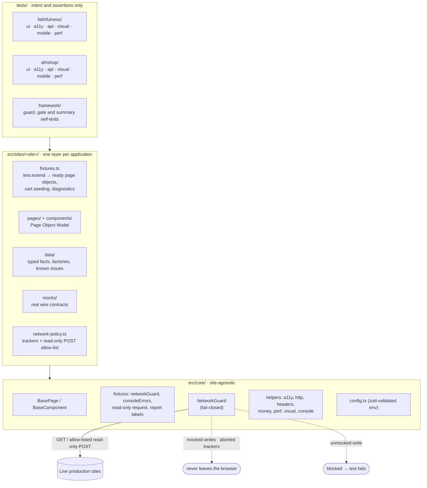
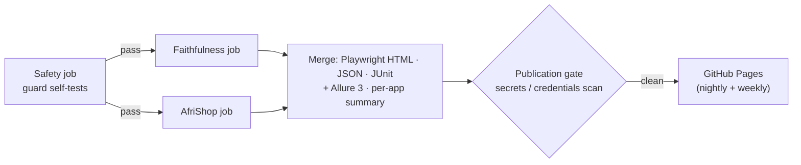

# Playwright + TypeScript E2E Framework for Two Live Production Sites

[](https://github.com/nmuonko/playwright-typescript-e2e-framework/actions/workflows/ci.yml)
[](https://github.com/nmuonko/playwright-typescript-e2e-framework/actions/workflows/nightly-smoke.yml)
[](https://github.com/nmuonko/playwright-typescript-e2e-framework/actions/workflows/weekly-regression.yml)
[](https://nmuonko.github.io/playwright-typescript-e2e-framework/)


End-to-end tests for two **live production** websites:

- [faithfulnesshomecare.com](https://faithfulnesshomecare.com), a home-care agency. Server-rendered React on
  TanStack Start; revenue comes from lead forms.
- [afrishop-usa.com](https://afrishop-usa.com), a French-language cross-border store. A React SPA on Supabase;
  revenue comes from search → cart → checkout.

The suite covers UI journeys, accessibility, HTTP/API contracts, visual regression, mobile emulation and light
performance checks on Chromium, Firefox and WebKit. Because the targets are real businesses, everything is built
around a **fail-closed network guard**: every submission (lead forms, checkout) is intercepted, its payload is
asserted, and it is answered with a mock that follows the site's real response contract. No production data is
ever written.

**Live reports:** [GitHub Pages](https://nmuonko.github.io/playwright-typescript-e2e-framework/) shows the latest
nightly smoke and weekly regression runs, with an Allure report, a Playwright HTML report and JUnit XML for each.

## At a glance

All numbers come from `npx playwright test --list` and the run reports, not estimates.

|                       |                                                                                         |
| --------------------- | --------------------------------------------------------------------------------------- |
| Test scenarios        | **160** unique tests, **346** executions across 11 Playwright projects                  |
| Projects              | 2 sites × {Chromium, Firefox, WebKit, iPhone 13, API} + framework self-tests            |
| Nightly smoke         | 39 executions: guard self-tests, then Chromium + API smoke for each site                |
| Mocked submissions    | 12 scenarios (`@mocked`): four lead forms and guest checkout, success and failure paths |
| Accessibility         | 21 scenarios: axe WCAG 2.2 AA scans and keyboard-only journeys                          |
| Visual baselines      | 6, rendered in the CI Docker image and committed                                        |
| Findings              | 18 public, classified as 13 verified defects and 5 observations                         |
| Known defects tracked | 7 findings are pinned by expected-failure tests that flip when the site is fixed        |

### Coverage matrix

Unique scenarios per suite, and the projects they run in.

| Suite                                    | Faithfulness | AfriShop | Chromium | Firefox | WebKit | iPhone 13 | API (no browser) |
| ---------------------------------------- | -----------: | -------: | :------: | :-----: | :----: | :-------: | :--------------: |
| Functional UI (`ui/`)                    |           48 |       31 |    ✓     |   ✓¹    |   ✓¹   |           |                  |
| Accessibility (`a11y/`)                  |           11 |       10 |    ✓     |   ✓¹    |   ✓¹   |           |                  |
| API & HTTP contracts (`api/`)            |           15 |       11 |          |         |        |           |        ✓         |
| Visual regression (`visual/`)            |            3 |        3 |    ✓     |         |        |           |                  |
| Mobile journeys (`mobile/`)              |            3 |        3 |          |         |        |     ✓     |                  |
| Performance, single cold load (`perf/`)  |            3 |        3 |    ✓     |         |        |           |                  |
| Framework self-tests (`tests/framework`) |              |          |    ✓     |         |        |           |                  |

¹ Seven AfriShop scenarios that hit live search (`@live-search`) run on Chromium and mobile only; see
[F-AS-12](docs/FINDINGS.md#f-as-12). The 16 framework self-tests never touch production.

What the suites cover:

- **Faithfulness:**
  - Lead forms: consultation, two-step assessment, referral and careers. Covers validation, conditional rules,
    the honeypot, payload assertions, and the success, rejection and outage paths.
  - ZIP coverage checker and 15 town pages.
  - Services navigation, pricing content, phone and email contact points, and a 54-URL sitemap sweep.
- **AfriShop:**
  - Search relevance and the empty state, numeric price sorting, pagination and category counts.
  - Product price breakdown, and cart arithmetic on a seeded cart (cents included).
  - Checkout validation, plus every branch of the mocked checkout call.
- **Accessibility:**
  - axe scans gate on serious and critical violations that are not already documented.
  - Keyboard tests for the skip link, menus, sorting, search and form completion.
- **HTTP contracts:**
  - Status codes, response-time budget, security headers, caching, HTTP→HTTPS redirects, and real vs soft 404s.
  - robots.txt and the sitemap, CSP consistency with the scripts the page actually loads, and a zod contract on a
    catalogue API response.

## Architecture





## How it works

### 1. What problem does this framework solve?

It gives continuous, trustworthy evidence that two revenue-critical production sites work, without ever creating a
lead, an account, a referral or an order. Testing production is usually avoided because of exactly that risk; here
it is made safe by design, so it can run every night.

### 2. Why Playwright with TypeScript?

- **One runner for every layer we need:** browser UI on three engines, mobile emulation, API requests, network
  interception, visual comparison and traces.
- **Web-first assertions and auto-waiting** remove hard-coded sleeps. `waitForTimeout` and `networkidle` are banned
  by lint.
- **Strict TypeScript** catches mistakes at compile time: `strict`, `noUncheckedIndexedAccess` and
  `exactOptionalPropertyTypes`, with type-aware ESLint including `no-floating-promises`. An unawaited assertion
  or a wrongly typed mock payload is a build error, not a flaky test.

### 3. Why the Page Object Model?

Pages encapsulate locators and intent-level actions, so specs read as journeys and a markup change is fixed in one
place. Pages use **inheritance** (`BasePage → FaithfulnessPage → ContactPage`) for shared chrome and "loaded" rules.
Widgets use **composition**: one `ConsultationForm` component serves `/contact`, the home page and 15 town pages.
Assertions stay in specs, except `expect*` helpers that define a component's correct state.

### 4. How does it support two different applications?

- **Shared core:** `src/core` holds everything site-agnostic: the guard, fixtures, base classes and helpers.
- **One layer per site:** each site has its own folder under `src/sites/` with pages, components, typed data,
  mocks, a network policy and fixtures that extend the core ones.
- **Separate projects:** each site gets its own Playwright projects (base URL, locale `en-US` vs `fr-FR`, time
  zone).
- **Platform-specific waits:** for example, TanStack hydration on one site and catalogue loading states on the
  other.

Adding a third site means a new `src/sites/<name>` folder and one entry in `playwright.config.ts`.

### 5. How are fixtures and reusable components organised?

- **Core fixtures** ([src/core/fixtures](src/core/fixtures/index.ts)):
  - `networkGuard` is attached before the page can navigate.
  - `page` depends on it, so no test can open a page without the guard.
  - `consoleErrors` collects unexpected console errors.
  - `request` is wrapped so API tests can only GET or HEAD.
  - An automatic fixture labels every test for Allure.
- **Site fixtures** hand tests ready page objects (`async ({ checkoutPage }) => …`) and site-specific helpers:
  - `seedCart` writes the AfriShop cart to `localStorage` before any script runs.
  - An automatic `catalogDiagnostics` fixture attaches catalogue responses on failure. It labels backend outages
    as environment-related.
- **Components** live in `components/` and are composed into pages.

### 6. How is test data managed?

- **Factories** use `@faker-js/faker` with RFC 2606 `example.com` emails, reserved `555-01xx` phone numbers, and an
  `[automated test]` prefix on free text, so nothing can reach a real inbox or phone.
- **Typed data files** hold stable business facts: navigation targets and their headings, the six core services,
  15 service areas, verified ZIP → town routes, the published rate and contact details. A wrong phone number on the
  site fails a test.
- **Data-driven specs** loop over those files: town pages, invalid field values, ZIP routes, key pages and sitemap
  URLs.
- **Seeded state:** the AfriShop cart is seeded with prices that include cents, so totals are tested independently
  of the live catalogue. Assertions on live content target invariants (sorted order, non-empty, arithmetic), never
  product counts or prices.

### 7. How are production-changing operations prevented?

The [`NetworkGuard`](src/core/network/network-guard.ts) evaluates every browser request in this order:

1. **Tracker** (ads and analytics): abort.
2. **Registered mock:** fulfil it, or abort it to simulate an outage.
3. **GET / HEAD / OPTIONS:** continue to production.
4. **Individually verified read-only POST** (four AfriShop catalogue and pricing endpoints): continue.
5. **Anything else:** abort, and **the test fails** with the blocked request attached.

Supporting controls:

- **Service workers** are blocked, so they cannot bypass routing.
- **Mocks are registered synchronously** in an in-memory list, so they cannot race the click that triggers the
  request.
- **Credential masking:** recorded request bodies have credential fields masked.
- **Self-tests first:** the guard's self-tests run in CI before any production test, and the production jobs only
  start if they pass.

The rationale and the verified allow-list are in
[ADR-004](docs/DECISIONS.md#adr-004--a-fail-closed-network-guard-for-testing-production).

### 8. How are API requests tested?

The browser-less `*-api` projects use Playwright's `request` fixture, wrapped in a read-only proxy that throws on
`post`, `put`, `patch` and `delete` before anything is sent. They check:

- status codes and the response-time budget;
- security headers and caching policy;
- HTTP→HTTPS redirects, and real vs soft 404s;
- robots.txt and the sitemap, plus a bounded-concurrency link sweep;
- CSP consistency with the scripts the page loads;
- a **zod schema contract** on a catalogue API response.

Inside browser tests, mocked submissions also assert the exact request payload. For Faithfulness this means
decoding TanStack's _seroval_ wire format.

### 9. How does CI/CD work?

| Workflow                                                          | Trigger                                                  | What it runs                                                                        |
| ----------------------------------------------------------------- | -------------------------------------------------------- | ----------------------------------------------------------------------------------- |
| [CI](.github/workflows/ci.yml)                                    | Every PR and push to `main`, manual                      | Lint, Prettier, typecheck → guard self-tests → Chromium + API smoke per site        |
| [Nightly production smoke](.github/workflows/nightly-smoke.yml)   | Daily 06:00 UTC, manual                                  | Guard self-tests → smoke per site → reports → GitHub Pages                          |
| [Weekly full regression](.github/workflows/weekly-regression.yml) | Sundays 07:00 UTC, manual                                | Guard self-tests → every suite on Chromium, Firefox, WebKit, iPhone 13, API → Pages |
| [E2E suite](.github/workflows/e2e.yml)                            | Called by the above; manual with `smoke` or `regression` | The reusable pipeline itself (no publishing when run by hand)                       |

- **Pinned environment:** test jobs run in `mcr.microsoft.com/playwright:v1.64.1-noble`, the image the visual
  baselines were rendered in. CI uses `updateSnapshots: 'none'`, so it can only compare.
- **Production load:** two workers per site, one retry, and one job per site at a time across all workflows
  (job-level `concurrency`). Sitemap sweeps, visual comparison and performance checks run weekly, not nightly.
- **Workflow security:** actions are pinned to commit SHAs, and workflows default to `contents: read`. Only the
  publishing job gets `pages: write`, and pull requests never do.
- **Honest results:** a genuine failure fails the job. Known defects stay visible as "expected to fail" and are not
  skipped.

### 10. How are failures investigated?

- **Evidence:** every failure has a screenshot. The first retry records a trace and video.
- **Attachments:** tests attach what they know, for example `network-guard.json` (blocked writes),
  `console-errors.json`, `catalog-responses.json` and axe results.
- **Run summary:** the job summary and the Pages landing page list failing tests per application. Failures the
  fixtures attribute to the environment, such as an unreachable backend, are marked _env._
- **Gated uploads:** in CI, failure evidence is uploaded as an artifact only after the publication gate has scanned
  it.

A worked example is in [docs/interview-walkthrough.md](docs/interview-walkthrough.md#4-debugging-a-real-failure-3-min).

### 11. How does cross-browser testing work?

Each site has Chromium, Firefox and WebKit desktop projects, plus an iPhone 13 (WebKit) project for mobile
journeys. Tests are engine-neutral:

- console patterns match each engine's wording;
- the skip-link test uses the right Tab behaviour on Safari;
- hydration waits handle WebKit's slower island hydration.

Visual and performance suites are Chromium-only by design. Fonts and timings differ per engine, so comparing
across them would measure the engine, not the site.

### 12. How can another engineer clone and run it?

Requires Node 22 or later. No credentials are needed: every variable in `.env.example` has a safe default.

```bash
git clone https://github.com/nmuonko/playwright-typescript-e2e-framework.git
cd playwright-typescript-e2e-framework
npm ci
npx playwright install --with-deps
npm run test:smoke
```

| Command                                       | What it runs                                                               |
| --------------------------------------------- | -------------------------------------------------------------------------- |
| `npm run test:smoke`                          | `@smoke` subset on every project                                           |
| `npm run test:regression`                     | Full suite (includes smoke)                                                |
| `npm run test:faithfulness`                   | One site, every project (`test:afrishop` for the other)                    |
| `npm run test:chromium`                       | Chromium + API projects only (fast local loop)                             |
| `npm run test:a11y`                           | Accessibility (`test:api`, `test:mobile`, `test:visual` work the same way) |
| `npx playwright test --project=framework`     | Safety-layer self-tests (no network)                                       |
| `npm run test:visual:docker`                  | Visual comparison inside the CI image (needs Docker)                       |
| `npm run visual:update`                       | Regenerate baselines after an intentional UI change (Docker)               |
| `npm run report`                              | Open the last Playwright HTML report                                       |
| `npm run report:allure`                       | Build and open the Allure report from the last run                         |
| `npm run lint` / `typecheck` / `format:check` | Quality gates (also run by the pre-commit hook)                            |

Visual tests skip outside Linux with an explicit reason, because the baselines are Linux renders. Use the Docker
command instead.

## Project structure

```
src/
  core/
    base.page.ts            BasePage (abstract), BaseComponent, waitForReactHydration
    config.ts               typed .env loader (zod)
    known-issues.ts         expected-failure and known-issue annotations
    reporting.ts            Allure labels (application → suite → browser)
    fixtures/index.ts       networkGuard, consoleErrors, read-only request, report labels
    network/                NetworkGuard (fail-closed), readOnlyRequest proxy
    helpers/                a11y, http (links/sitemap/robots), headers (CSP), money, perf, visual, console
    data/factories.ts       faker-based person factory (safe domains and phone ranges)
  sites/
    faithfulness/           pages/ components/ data/ mocks/ network-policy.ts fixtures.ts
    afrishop/               pages/ components/ data/ mocks/ network-policy.ts fixtures.ts
tests/
  framework/                self-tests for the guard, the publication gate and the run summary
  faithfulness/             ui/ a11y/ api/ visual/ mobile/ perf/ and __screenshots__/
  afrishop/                 ui/ a11y/ api/ visual/ mobile/ perf/ and __screenshots__/
scripts/                    report-summary.ts · build-pages-index.ts · scan-report.ts · ci/
docs/                       TEST-PLAN.md · DECISIONS.md · FINDINGS.md · interview-walkthrough.md
.github/workflows/          ci.yml · e2e.yml · nightly-smoke.yml · weekly-regression.yml · publish-report.yml
docker-compose.yml          CI-identical container for visual baselines
allurerc.mjs                Allure 3 report configuration
```

## Reporting

- **Playwright HTML report:** steps, screenshots, traces and attachments per test. Published on Pages, and uploaded
  as an artifact on every run.
- **Allure 3 report:** grouped by application → suite type → browser, with environment info. Trend history is
  carried between published runs.
- **JUnit XML** for any CI dashboard, and a **per-application summary** in each run's GitHub job summary.
- **Publication gate:** reports are published only after [`scan-report.ts`](scripts/scan-report.ts) finds no
  secrets or unmasked credentials. It checks inside zipped traces too. Tests only ever see public pages, so a
  report contains what any visitor's browser would see.

## Design decisions

Thirteen ADRs are in [docs/DECISIONS.md](docs/DECISIONS.md):

- strict TypeScript;
- the project matrix;
- POM, combining inheritance and composition;
- the fail-closed guard;
- contract-faithful mocks;
- locator policy;
- known-defect handling;
- waiting strategy;
- visual baselines;
- tagging;
- production etiquette;
- test data;
- reporting and publication.

The original risk-based plan is in [docs/TEST-PLAN.md](docs/TEST-PLAN.md).

## Findings

[docs/FINDINGS.md](docs/FINDINGS.md) lists 18 public findings. Each is classified as a verified defect or an
observation, with steps, expected and actual behaviour, and what is and isn't proven. Environment-related failures
are listed separately. Highlights:

- AfriShop search results sorted "Prix: croissant" are not in price order (95 inversions in one query).
- Under sustained traffic, AfriShop catalogue endpoints returned empty HTTP 200 responses instead of errors.
- Critical axe `button-name` violations on every AfriShop page.
- Faithfulness references a Google Ads tag on every page, but its own CSP blocks it.
- Faithfulness `/refer` renders without the site header, footer or main landmark.

## Honest limitations

- **Live content changes daily.** Content, prices and catalogue size change, so assertions target invariants and
  documented business facts. A content change can still require a data-file update.
- **Out of scope:** payment (Stripe), authenticated areas and admin routes.
- **External dependencies:** AfriShop depends on upstream catalogue providers and its own backend. When the backend
  is unreachable, AfriShop runs fail and are marked as environment-related. They are not hidden.
- **Performance:** figures are single lab runs from a CI runner, not field data.
- **Visual baselines** cover six stable components, not whole pages, because live product imagery changes.
