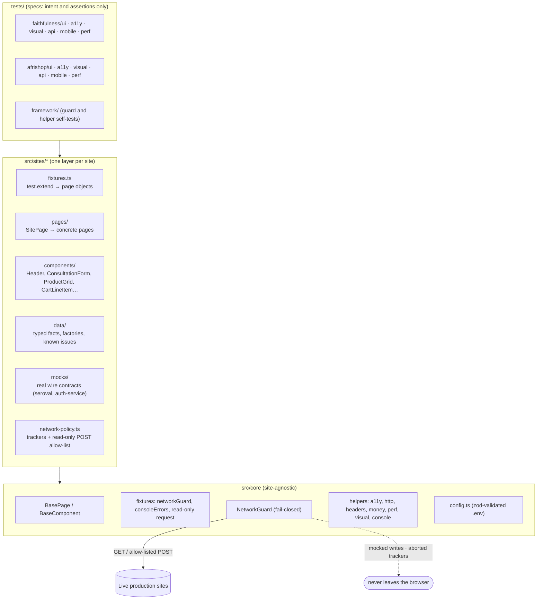

# Playwright + TypeScript E2E Framework for Two Live Production Sites

[](https://github.com/nmuonko/playwright-typescript-e2e-framework/actions/workflows/regression.yml)
[](https://github.com/nmuonko/playwright-typescript-e2e-framework/actions/workflows/pr.yml)
[](https://nmuonko.github.io/playwright-typescript-e2e-framework/)


An end-to-end test framework for two **live production** websites: a home-care agency
([faithfulnesshomecare.com](https://faithfulnesshomecare.com), server-rendered React on TanStack Start) and a
cross-border e-commerce store ([afrishop-usa.com](https://afrishop-usa.com), a French-language React SPA on
Supabase). It covers UI journeys, accessibility, HTTP contracts, visual regression, mobile and light performance on
Chromium, Firefox and WebKit. Because the targets are real businesses, the framework is built around a **fail-closed
network guard**: every submission (lead forms, account registration, checkout) is intercepted, its payload asserted,
and answered with a mock that follows the site's real response contract. No production data is ever written. The
suite has already surfaced 20 documented observations, from a search sort that doesn't sort to
search results that come back empty under load. See [docs/FINDINGS.md](docs/FINDINGS.md).

## At a glance

|                    |                                                                                     |
| ------------------ | ----------------------------------------------------------------------------------- |
| Unique test cases  | 157 (343 executions across 11 projects)                                             |
| Projects           | 2 sites × {Chromium, Firefox, WebKit, iPhone 13, API} + framework self-tests        |
| Smoke subset       | 86 executions (`@smoke`); the Chromium + API part runs on every PR                  |
| Mocked submissions | 32 executions (`@mocked`): 4 lead forms + guest checkout, success and failure paths |
| Accessibility      | 59 executions: axe WCAG 2.2 AA scans and keyboard tests                             |
| Visual baselines   | 6, rendered in the CI Docker image and committed                                    |
| Findings           | 20 observations with evidence, 8 tracked by expected-failure tests                  |

## Architecture



**Request flow through the guard:** tracker → abort · registered mock → fulfil · GET/HEAD → production ·
allow-listed read-only POST → production · **anything else → abort, and the test fails** with the blocked request
attached.

## Tech stack

- **Playwright Test 1.64** with **TypeScript** (`strict`, `noUncheckedIndexedAccess`, `exactOptionalPropertyTypes`)
- **@axe-core/playwright** for WCAG 2.0–2.2 A/AA scans
- **@faker-js/faker** for test data, **zod** for env config and API contract validation
- **ESLint** (`typescript-eslint` strict type-checked, `no-floating-promises`, `eslint-plugin-playwright`),
  **Prettier**, **Husky** and **lint-staged**
- **GitHub Actions** (sharded matrix, blob-report merge, GitHub Pages) and **Docker** (pinned Playwright image)

## Project structure

```
src/
  core/
    base.page.ts            BasePage (abstract), BaseComponent, waitForReactHydration
    config.ts               typed .env loader (zod)
    known-issues.ts         expected-failure and known-issue annotations
    fixtures/index.ts       networkGuard, consoleErrors, read-only request
    network/                NetworkGuard (fail-closed), readOnlyRequest proxy
    helpers/                a11y, http (links/sitemap/robots), headers (CSP), money, perf, visual, console
    data/factories.ts       faker-based person factory (safe domains and phone ranges)
  sites/
    faithfulness/           pages/ components/ data/ mocks/ network-policy.ts fixtures.ts
    afrishop/               pages/ components/ data/ mocks/ network-policy.ts fixtures.ts
tests/
  framework/                self-tests for the guard and helpers (no network)
  faithfulness/             ui/ a11y/ visual/ api/ mobile/ perf/ and __screenshots__/
  afrishop/                 ui/ a11y/ visual/ api/ mobile/ perf/ and __screenshots__/
docs/                       TEST-PLAN.md · DECISIONS.md · FINDINGS.md
.github/workflows/          pr.yml · regression.yml
docker-compose.yml          CI-identical container for visual baselines
```

## Running locally

Requires Node 22+.

```bash
npm ci
npx playwright install --with-deps
cp .env.example .env          # optional: every variable has a safe default
```

| Command                      | What it runs                                                 |
| ---------------------------- | ------------------------------------------------------------ |
| `npm test`                   | Everything (all sites, all projects)                         |
| `npm run test:smoke`         | `@smoke` subset                                              |
| `npm run test:regression`    | Full suite (includes smoke)                                  |
| `npm run test:faithfulness`  | One site, every project (`test:afrishop` for the other)      |
| `npm run test:chromium`      | Chromium + API projects only (fast local loop)               |
| `npm run test:a11y`          | Accessibility (`test:api`, `test:mobile` work the same way)  |
| `npm run test:visual:docker` | Visual comparison inside the CI image                        |
| `npm run visual:update`      | Regenerate baselines after an intentional UI change (Docker) |
| `npm run report`             | Open the last HTML report                                    |
| `npm run lint` / `typecheck` | Quality gates (also run in the pre-commit hook)              |

Visual tests skip outside Linux with an explicit reason, because baselines are rendered in the CI image. Use the
Docker commands instead.

## CI/CD

| Workflow         | Trigger                           | What it does                                                                      |
| ---------------- | --------------------------------- | --------------------------------------------------------------------------------- |
| `pr.yml`         | Pull requests                     | Lint, format check, typecheck → `@smoke` on Chromium + API + framework self-tests |
| `regression.yml` | Push to `main`, nightly 06:00 UTC | All 11 projects in 4 parallel shards → merged HTML + JUnit report → GitHub Pages  |

- Test jobs run inside `mcr.microsoft.com/playwright:v1.64.1-noble`, the same image used to render the visual
  baselines. CI uses `updateSnapshots: 'none'`, so it can only compare.
- Retries are 2 in CI only. Traces and video are kept on first retry and uploaded as artifacts on failure.
- `concurrency` groups stop overlapping regression runs against production.
- Tests that hit AfriShop's live search (`@live-search`) run on Chromium and mobile only, to keep burst load low
  (see F-AS-12).

## Test strategy

Priorities come from a risk assessment of what would hurt each business most (see
[docs/TEST-PLAN.md](docs/TEST-PLAN.md)).

- **Faithfulness** (revenue = leads): consultation, assessment (two-step), referral and careers forms, covering
  validation, conditional rules, honeypot, payload assertions and success, rejection and outage paths. Also the ZIP
  coverage checker and town pages, service navigation, pricing content, phone and email contact points, and a
  sitemap sweep of all 54 URLs.
- **AfriShop** (revenue = discovery → cart → checkout): search relevance and empty state, price sorting checked as
  numeric order, pagination, category counts, product price breakdown, cart arithmetic on a seeded cart (cents
  included), selection and removal, persistence, checkout validation, and every branch of the mocked registration
  call.
- **Accessibility:** axe scans gate on serious and critical violations not already documented. There are keyboard
  tests for the skip link, menus, sort control, search and form completion, and form errors are checked as
  accessible descriptions.
- **HTTP contracts:** status, response-time budget, security headers, caching, HTTP→HTTPS, real vs soft 404,
  robots and sitemap, CSP consistency with the scripts the page actually loads, and zod validation of a catalogue
  API response.
- **Visual, mobile, performance:** six stable components, key journeys on iPhone 13 (WebKit), and one cold-load
  measurement (load, LCP, CLS) per key page.

## Design decisions

Full ADRs are in [docs/DECISIONS.md](docs/DECISIONS.md). The short version:

- **POM with inheritance and composition.** Pages inherit navigation and site-specific "loaded" rules
  (`BasePage → FaithfulnessPage → ContactPage`). Widgets such as the consultation form are composed, so one
  component serves `/contact`, the home page and 15 town pages. Fixtures hand tests ready page objects.
- **Network mocking on live sites.** Testing production safely means submissions must be intercepted, and the
  interception has to fail closed: a missing mock becomes a red test, not a real lead. Mocks reproduce the sites'
  real contracts, read from their public bundles: TanStack's seroval format with `x-tss-serialized` on one site,
  Supabase's `{ ok, code }` registration contract on the other. So the UI's genuine success and error paths are
  exercised.
- **User-facing locators.** `getByRole` and `getByLabel` make the tests double as accessibility checks. The few
  exceptions are commented and tied to the finding that forces them.
- **How flakiness is prevented.**
  - Waits use real signals: TanStack hydration, React props on a control, cards-or-empty-state. There is no
    `waitForTimeout` and no `networkidle`; both are banned by lint.
  - Every new test was run with `--repeat-each=3`, and each flake was traced to a cause rather than retried away.
    The causes included a price parser bug, a hydration race on WebKit, a loading-state counter, and a backend that
    returns empty results under load.
  - Failures carry diagnostics (catalogue responses, axe results, blocked requests) as report attachments.
- **Known defects stay visible.** Expected-failure tests and known-issue annotations keep findings in the report
  without making the build permanently red, and a fixed issue announces itself.

## Findings

Twenty observations are documented in [docs/FINDINGS.md](docs/FINDINGS.md), each with steps, expected and actual
behaviour, and what is and isn't proven. Highlights:

- AfriShop search results sorted "Prix: croissant" are not in price order (95 inversions in one query).
- Under sustained traffic, AfriShop catalogue endpoints return empty HTTP 200 responses instead of errors.
- Critical axe `button-name` violations on every AfriShop page.
- Faithfulness references a Google Ads tag on every page that its own CSP blocks.
- Faithfulness `/refer` renders without the site header, footer or main landmark.

## Honest limitations

- These are third-party production sites. Content, prices and catalogue size change daily, so assertions target
  invariants and documented business facts. A content change may still require a data-file update.
- Payment (Stripe), authenticated areas and admin routes are out of scope.
- AfriShop catalogue responses depend on upstream providers. See F-AS-12 for how failures caused by them are
  labelled.
- Performance figures are single lab runs, not field data.
